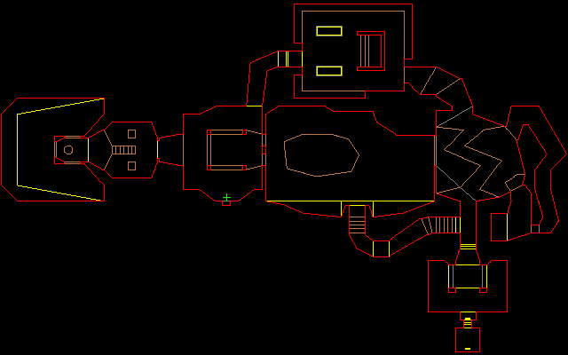

# sqldoom

Doom running inside [DuckDB](https://duckdb.org), built from scratch, one part at a time.

| Part | Goal | Status |
|------|------|--------|
| 1 | Import a WAD file into relational tables | done |
| 2 | Draw a top-down map with SQL | done |
| 3 | Render walls in BSP order | next |
| 4 | Floors/ceilings, sprites, game logic | planned |

## Setup

Requires [uv](https://docs.astral.sh/uv/). DuckDB has no wheels for Python 3.15 yet, so the project pins 3.12.

```sh
uv sync
```

### Getting doom1.wad

The shareware `doom1.wad` (episode 1) is freely redistributable but not committed here. The Debian package
contains it:

```sh
mkdir -p wad && cd wad
curl -fsSLO http://deb.debian.org/debian/pool/non-free/d/doom-wad-shareware/doom-wad-shareware_1.9.fixed-5_all.deb
mkdir x && dpkg-deb -x doom-wad-shareware_*.deb x && find x -iname '*.wad' -exec cp {} . \; && rm -rf x *.deb
sha1sum doom1.wad   # 5b2e249b9c5133ec987b3ea77596381dc0d6bc1d (v1.9)
```

## Part 1: importing a WAD

```sh
uv run sqldoom-import wad/doom1.wad doom1.duckdb
# imported 1264 lumps and 9 maps into doom1.duckdb
```

```
usage: sqldoom-import [-h] [--force] wad database
```

- `wad`: an IWAD or PWAD file.
- `database`: the DuckDB file to create. The command refuses to overwrite it unless you pass `--force`.

Errors go to stderr and exit with code 1:

| Message | Cause |
|---------|-------|
| `error: file not found: <path>` | The WAD path does not exist. |
| `error: not a WAD file: <path>` | The file does not start with `IWAD`/`PWAD`. |
| `error: corrupt WAD file: <path>` | The directory or a map lump points outside the file, or a lump has a partial record. |
| `error: database already exists: <path> (use --force to replace)` | The output exists and `--force` was not given. |

The import fails before it writes anything. With `--force`, the new database is built in a scratch file and swapped
in at the end, so a failed import never damages an existing database.

### The WAD format in one minute

A WAD is a flat archive of named blobs called *lumps*. It starts with a 12-byte header (`IWAD`, lump count,
directory offset) and ends with a directory of 16-byte entries (offset, size, 8-char name). A map is an empty marker
lump (`E1M1`) followed by its data lumps. Each data lump is an array of fixed-size records that point at each other
by array index.

### Schema

Every map table is keyed by `(map, id)`, where `id` is the record's index in its lump.

| Table | One row per | Key columns |
|-------|-------------|-------------|
| `lumps` | directory entry, with raw bytes in `data` | `idx`, `name`, `filepos`, `size` |
| `maps` | map marker | `name`, `lump_idx` |
| `vertexes` | 2D point | `x`, `y` |
| `linedefs` | wall line between two vertexes | `v1`, `v2`, `front_sidedef`, `back_sidedef` (NULL = one-sided wall) |
| `sidedefs` | one face of a linedef | textures (NULL = `-`, none), `sector` |
| `sectors` | area with floor/ceiling heights | `floor_height`, `ceiling_height`, `light_level` |
| `things` | monster, item or player start | `x`, `y`, `angle`, `type` |
| `segs` | piece of a linedef produced by the BSP builder | `v1`, `v2`, `angle` (0..65535), `linedef`, `direction` |
| `ssectors` | convex subsector (BSP leaf) | `first_seg`, `seg_count` |
| `nodes` | BSP split line | partition `x, y, dx, dy`, bounding boxes, `right_child`/`left_child` + `*_is_ssector` |

### Exploring it

```sh
duckdb doom1.duckdb    # or: uv run python -c "import duckdb; ..."
```

```sql
-- Biggest maps by wall count
SELECT map, count(*) AS walls FROM linedefs GROUP BY map ORDER BY walls DESC;

-- Every wall of E1M1 as a segment with real coordinates
SELECT l.id, a.x AS x1, a.y AS y1, b.x AS x2, b.y AS y2, l.back_sidedef IS NULL AS solid
FROM linedefs l
JOIN vertexes a ON a.map = l.map AND a.id = l.v1
JOIN vertexes b ON b.map = l.map AND b.id = l.v2
WHERE l.map = 'E1M1';

-- Player 1 start
SELECT x, y, angle FROM things WHERE map = 'E1M1' AND type = 1;
```

### Why the loader uses CSV

DuckDB is columnar, so per-row inserts are its worst case. On doom1.wad (~40k map records), row-by-row
`executemany` took ~80 s, and binding whole Python lists as `UNNEST` parameters still took ~28 s. Writing a temporary
CSV and running `COPY` (DuckDB's native, vectorized reader) takes about a second end to end.

## Part 2: the automap, rendered by SQL



```sh
uv run sqldoom-automap doom1.duckdb E1M1               # ASCII art in the terminal (120x60)
uv run sqldoom-automap doom1.duckdb E1M1 -o e1m1.png   # PNG image (640x400)
uv run sqldoom-automap doom1.duckdb e1m6 --size 200x90 # map names are case-insensitive
```

```
usage: sqldoom-automap [-h] [--size WxH] [-o OUTPUT] database map
```

- `--size WxH`: characters for ASCII, pixels for PNG. Both values must be between 8 and 4096.
- `-o OUTPUT`: write a PNG instead of printing ASCII. Prints `wrote <path> (WxH)`.

Errors exit with code 1 and leave no output file: `error: file not found: <path>`, `error: map not found: <MAP>`,
`error: not a sqldoom database: <path>` and `error: cannot write <path>: <strerror>`. An invalid `--size` is a
usage error (exit code 2).

| Line kind | Rule | ASCII | PNG |
|-----------|------|-------|-----|
| Wall | one-sided linedef | `#` | red |
| Floor step | two-sided, floor heights differ | `+` | brown |
| Ceiling step | two-sided, only ceiling heights differ | `=` | yellow |
| Plain | two-sided, same heights | `.` | gray |
| Player 1 start | thing type 1 | `@` | green cross |

When two kinds land on the same pixel, the one higher in the table wins.

### How SQL draws it

The renderer is `src/sqldoom/sql/automap.sql`: DuckDB `TEMP` table macros that Python loads and calls. Python never
touches a pixel. It only prints the text SQL returns, or wraps the RGB bytes SQL returns in a PNG.

1. **Fit**: the map's bounding box and a single `scale` fit the map into the screen with a 1-pixel margin, keeping
   proportions. World y grows upwards and screen y grows downwards, so the formula uses `max_y - y`. Terminal cells
   are about twice as tall as they are wide, so ASCII mode uses a pixel `aspect` of 2.
2. **Classify**: each linedef is joined to its sidedefs and sectors to get its kind.
3. **Rasterize**: SQL has no loops, but `LATERAL generate_series(0, n)` fans each line out into one row per
   pixel. This is the DDA algorithm: `n = max(|dx|, |dy|)` steps, each one rounded to a pixel.
4. **Resolve**: `GROUP BY x, y` with `arg_min(kind, priority)` keeps one kind per pixel.
5. **Fill**: the full `width x height` grid comes from a cross join of two `generate_series`. A `LEFT JOIN` leaves
   empty pixels as background.
6. **Encode**: `string_agg(... ORDER BY y, x)` serializes the grid, as characters for ASCII or as hex RGB that
   `unhex()` turns into a single BLOB of `width * height * 3` bytes.

You can call the macros yourself. In the `duckdb` CLI, load the file with `.read`; from Python, use
`con.execute(open("src/sqldoom/sql/automap.sql").read())`.

```sql
.read src/sqldoom/sql/automap.sql
SELECT kind, count(*) FROM automap_pixels('E1M1', 640, 400, 1.0) GROUP BY kind;
SELECT text FROM automap_ascii('E1M1', 100, 45);
```

## Tests

```sh
uv run pytest
```

Unit tests build tiny WADs byte by byte (`tests/wadbuilder.py`). The automap tests use a 180x160 room whose scale
works out exactly, so they compare the full ASCII output and decode the PNG to check individual pixels. `tests/test_doom1_wad.py` checks record counts and
cross-references on the real WAD. It is skipped when `wad/doom1.wad` is missing; set `SQLDOOM_WAD` to use another path.
